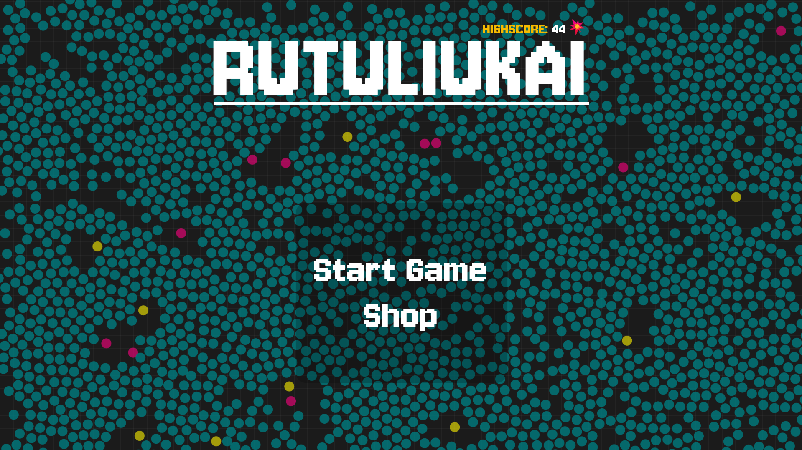
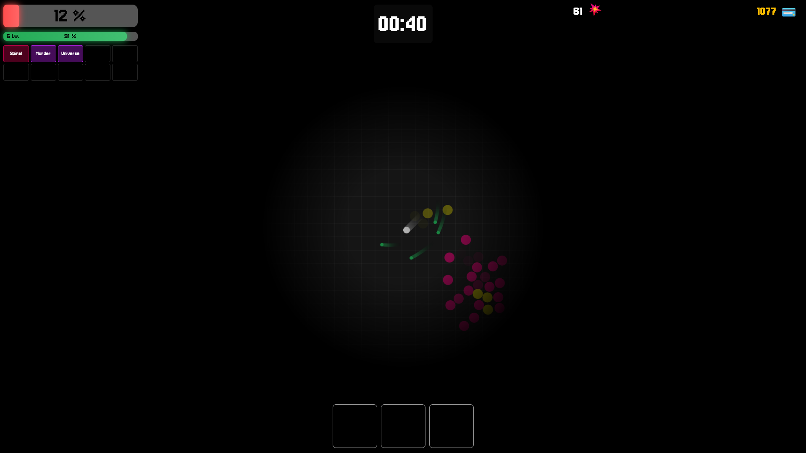
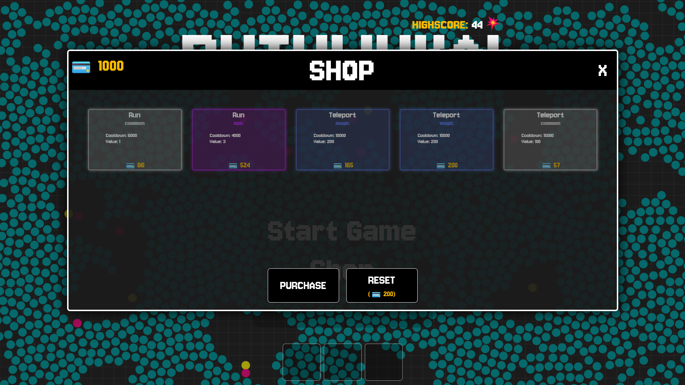
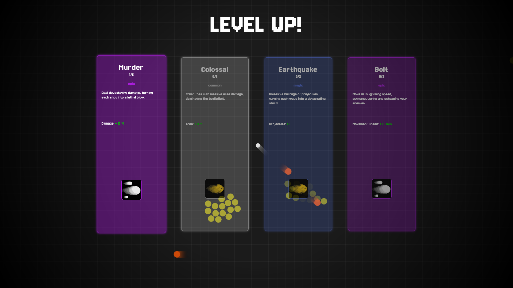
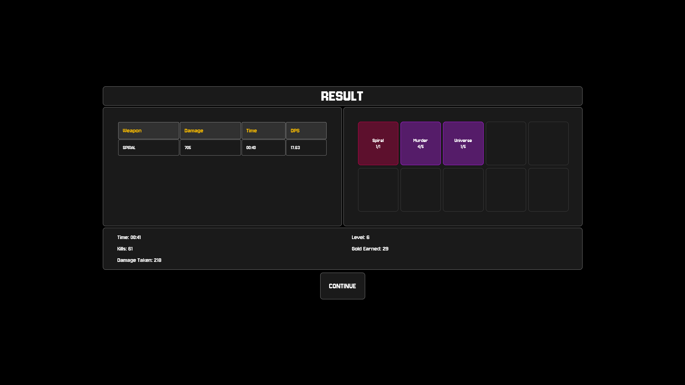

# Rutuliukai

Rutuliukai is a browser arena survival game. Dodge enemies, level up, and build a loadout that can survive the next wave.



## How to play

- **W A S D** to move. Weapons fire automatically.
- **J K L** to activate the abilities in slots 1, 2, and 3.
- In the **Shop**, select an item, choose an ability slot at the bottom of the screen, then click **Purchase**.
- Choose an upgrade when you level up. After a run, the results screen shows your kills, time, and weapon damage. Your best kill count is saved in your browser.

## Run locally

From the project root, start a static server:

```sh
python -m http.server 5501 --bind 127.0.0.1
```

Open [the local game](http://127.0.0.1:5501/). When the loading screen says **READY**, click anywhere or press a key to open the menu and enable audio.

The game uses HTML, CSS, JavaScript, and JSON. Edit the files in `data/` to change gameplay settings or the shop and upgrade catalog.

<details>
<summary>More screenshots</summary>

**Arena**



**Shop**



**Level up**



**Results**



</details>
